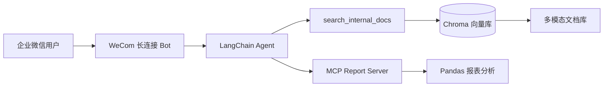

# ARobot — 企微智能客服

基于 **LangChain** 的企业微信（企信）智能客服：内部多模态文档 RAG 问答 + 通过 **MCP** 处理用户上传的 Excel/CSV 报表。

## 架构



| 模块 | 说明 |
|------|------|
| `channels/wecom.py` | 企业微信智能机器人 WebSocket 长连接（无需公网 IP） |
| `rag/` | PDF/Office/图片/文本 入库与检索 |
| `agent/` | LangChain Agent + `langchain-mcp-adapters` |
| `mcp_servers/report_server/` | 报表 MCP：汇总、筛选、聚合、TopN |

## Docker 部署（独立服务）

三个独立容器，通过 `docker-compose` 编排：

| 服务 | 说明 | 端口 |
|------|------|------|
| `mcp-report` | 报表 MCP（Streamable HTTP） | 8000 |
| `bot` | 企微智能客服 + LangChain Agent | — |
| `ingest` | 文档入库（`--profile tools` 一次性任务） | — |

`bot` 与 `mcp-report` 共享卷 `arobot-data`（`/app/data`），用户上传的报表路径在两侧一致。

```bash
cp .env.example .env
# 填写 OPENAI_API_KEY、WECOM_BOT_ID、WECOM_BOT_SECRET

docker compose up -d --build

# 首次导入知识库
docker compose --profile tools run --rm ingest

# 查看日志
docker compose logs -f bot
docker compose logs -f mcp-report
```

仅启动 MCP 服务（本地调试 Agent 时）：

```bash
docker compose up -d mcp-report
# .env 中设置 MCP_REPORT_URL=http://localhost:8000/mcp
```

停止并清理：

```bash
docker compose down
# docker compose down -v   # 同时删除向量库卷
```

## 快速开始（本地 Python）

### 1. 安装

```bash
cd d:\project\arobot
python -m venv .venv
.venv\Scripts\activate
pip install -e .
cp .env.example .env
# 编辑 .env：OPENAI_API_KEY、WECOM_BOT_ID、WECOM_BOT_SECRET
```

### 2. 导入内部文档

将 PDF、Word、图片、Markdown 等放入 `data/documents/`，然后：

```bash
arobot-ingest
# 或指定路径
arobot-ingest ./data/documents
```

### 3. 配置企业微信智能机器人

1. 登录 [企业微信管理后台](https://work.weixin.qq.com/) → 智能机器人
2. 创建机器人，开启 **API 模式 → 长连接**
3. 将 `Bot ID` 和 `Secret` 写入 `.env` 的 `WECOM_BOT_ID` / `WECOM_BOT_SECRET`

### 4. 启动

```bash
# 生产：连接企微
arobot bot

# 本地调试（无需企微）
arobot console
```

控制台模式示例：

```
You> 请假流程是什么？
You> /file D:\reports\sales.xlsx 按区域汇总销售额
```

## MCP 报表工具

`mcp_servers/report_server/server.py` 提供：

| 工具 | 功能 |
|------|------|
| `report_summary` | 行列数、字段类型、缺失值、数值统计 |
| `report_filter` | 按条件筛选并导出 |
| `report_aggregate` | 分组聚合 |
| `report_top_n` | 排序取 Top N |

**Resources**（`@mcp.resource`）

| URI | 说明 |
|-----|------|
| `report://guide` | 格式、运算符、工具说明（JSON） |
| `report://uploads` | 上传目录中的报表清单 |
| `report://file/{filename}` | 按文件名预览前 20 行 |

**Prompts**（`@mcp.prompt`）

| 名称 | 说明 |
|------|------|
| `analyze_report` | 生成完整分析任务的用户消息 |
| `filter_report` | 生成筛选导出任务的用户消息 |

Agent 通过 `langchain-mcp-adapters` 以 stdio 子进程自动加载该服务。

单独测试 MCP：

```bash
python mcp_servers/report_server/server.py
```

## 环境变量

见 [`.env.example`](.env.example)。LLM 使用 OpenAI 兼容接口，可对接 DeepSeek、通义、本地 vLLM 等。

## 目录结构

```
arobot/
├── docker/               # Dockerfile（bot / mcp）
├── docker-compose.yml
├── src/arobot/           # 主应用
├── mcp_servers/          # MCP 服务
├── data/documents/       # 待入库文档
├── data/chroma/          # 向量库（自动生成）
└── data/uploads/         # 用户上传报表（自动生成）
```

## 扩展

- **更多 MCP**：在 `service_agent.py` 的 `MultiServerMCPClient` 中增加 server 配置
- **其他 IM**：参考 `channels/wecom.py` 实现新 Channel
- **权限**：设置 `WECOM_ALLOW_FROM=user1,user2`
